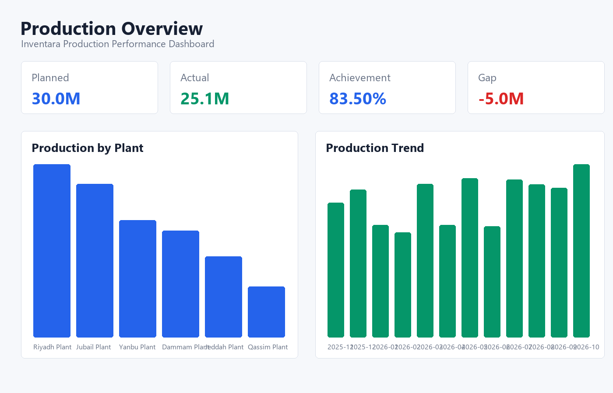
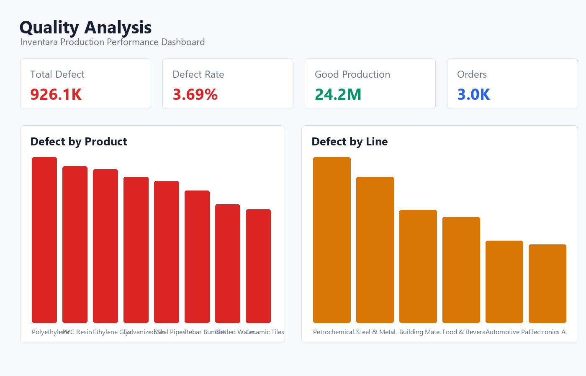
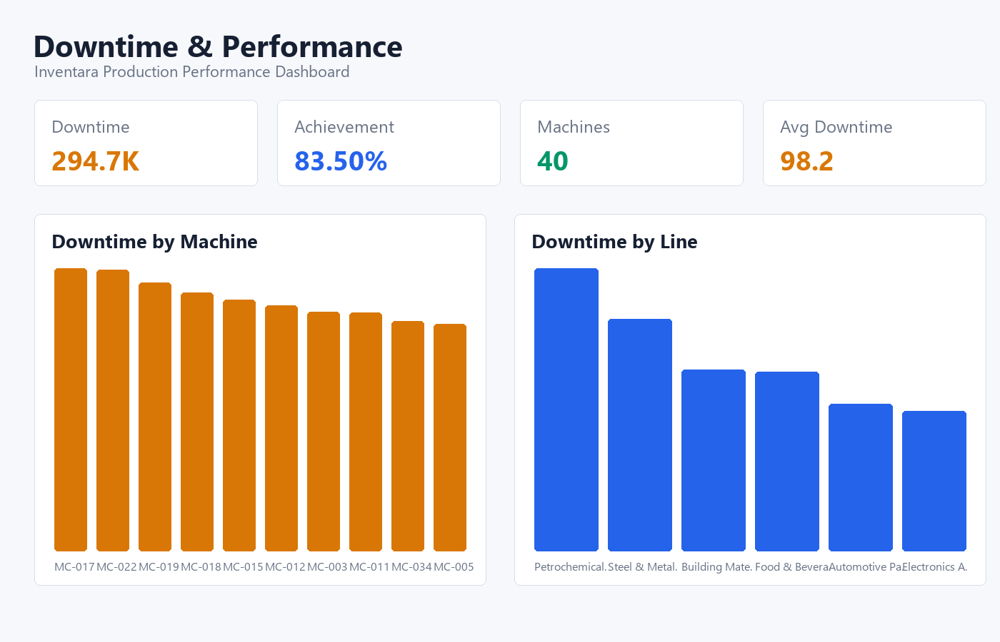
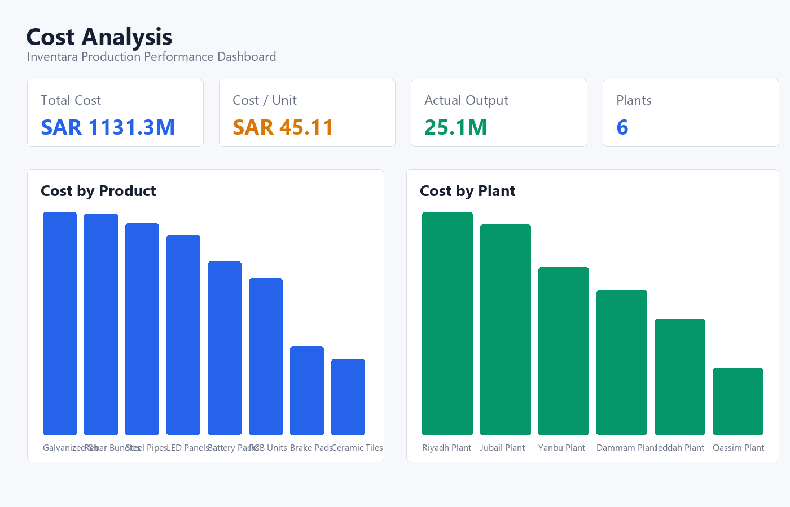

# Inventara

Inventara is a manufacturing analytics workspace for monitoring production achievement, product quality, machine downtime, and production cost across Saudi manufacturing production orders from 2024 to 2026.

The workflow uses Python for data cleaning and dashboard image generation, Streamlit for interactive monitoring, PostgreSQL for analytical querying, and notebooks for exploratory data analysis.



## Business Context

Manufacturing teams need a clear view of whether production output meets plan, which product lines create quality risk, which machines cause downtime, and which products drive high unit cost. Inventara turns raw production order data into clean analytical tables, KPI summaries, SQL-ready datasets, dashboard preview images, and an interactive monitoring app.

## Key Questions

- How much actual production was delivered compared with planned production?
- Which product lines and products have the highest defect volume or defect rate?
- Which machines contribute the most downtime?
- Which products and plants drive the highest production cost?
- What operational areas should be prioritized for improvement?

## Executive Summary

- Total orders: **3,000**
- Planned production: **30.03M units**
- Actual production: **25.08M units**
- Production achievement: **83.50%**
- Production gap: **-4.95M units**
- Good production: **24.15M units**
- Defect rate: **3.69%**
- Downtime: **294,674 minutes**
- Production cost: **SAR 1.13B**
- Cost per unit: **SAR 45.11**

## Dashboard Preview

The Inventara dashboard previews are generated from the cleaned dataset using Python.

The interactive Inventara dashboard is available in `dashboard/app.py`.

| Production Overview | Quality Analysis |
| --- | --- |
|  |  |

| Downtime & Performance | Cost Analysis |
| --- | --- |
|  |  |

## Tech Stack

- **Python:** data cleaning, KPI generation, dashboard image generation
- **Pandas / NumPy:** transformation and metric calculation
- **Pillow:** static dashboard preview rendering
- **Streamlit:** interactive dashboard application
- **PostgreSQL:** relational schema, import workflow, analytical SQL
- **Jupyter Notebook:** exploratory data analysis

## Repository Structure

```text
data/
  manufacturing-production-ksa-2024-2026.csv
  raw/manufacturing.csv
  processed/inventara_clean.csv
  processed/inventara_insights.md
notebooks/
  01_data_cleaning.ipynb
  02_eda.ipynb
sql/
  01_create_database.sql
  02_create_tables.sql
  03_data_cleaning.sql
  04_kpi_analysis.sql
  05_import_clean_csv.sql
dashboard/
  app.py
src/
  preprocess.py
  import_to_postgres.py
  generate_dashboard_images.py
images/
  overview.png
  quality.png
  downtime.png
  cost.png
```

## Dataset

Source file: `data/manufacturing-production-ksa-2024-2026.csv`

Working raw file: `data/raw/manufacturing.csv`

Original dataset reference: [Saudi Manufacturing Production Dataset 2024-2026](https://prime-levels.com/data-hub/saudi-manufacturing-production-orders-2024-2026) by Prime Levels. The dataset contains 3,000 Saudi manufacturing production work orders with output, defects, downtime, and costs in SAR for 2024-2026.

The cleaning pipeline standardizes column names, parses production dates, validates production values, removes duplicates, and creates analysis-ready metrics:

- `good_production`
- `production_achievement_pct`
- `defect_rate_pct`
- `production_gap`
- `cost_per_unit`
- calendar columns such as `year`, `quarter`, and `year_month`

## How to Run Inventara

Install dependencies:

```bash
pip install -r requirements.txt
```

Run the preprocessing pipeline:

```bash
python src/preprocess.py
```

Generate dashboard preview images:

```bash
python src/generate_dashboard_images.py
```

Run the interactive Inventara dashboard:

```bash
python -m streamlit run dashboard/app.py
```

Outputs:

- `data/processed/inventara_clean.csv`
- `data/processed/inventara_insights.md`
- `images/overview.png`
- `images/quality.png`
- `images/downtime.png`
- `images/cost.png`

## PostgreSQL Workflow

This workflow is optional. Use it when you want to run KPI analysis in PostgreSQL; otherwise, the Python pipeline, generated dashboard images, and Streamlit app are enough to reproduce the Inventara outputs.

Automatic import:

```bash
python src/import_to_postgres.py --host localhost --port 5432 --user postgres --password postgres
```

The importer creates the `inventara` database when possible, recreates the `production` table, imports `data/processed/inventara_clean.csv`, and runs SQL cleaning checks.

Manual import:

1. Run `sql/01_create_database.sql`.
2. Connect to `inventara`.
3. Run `sql/02_create_tables.sql`.
4. Run the `\copy` helper in `sql/05_import_clean_csv.sql`.
5. Run `sql/03_data_cleaning.sql`.
6. Use `sql/04_kpi_analysis.sql` for KPI and dashboard analysis queries.

## Insights

- Food & Beverage has the highest defect rate at **3.80%**.
- Machine **MC-017** records the highest downtime at **10,779 minutes** with production achievement of **77.88%**.
- **LED Panels** has the highest cost per unit at **SAR 118.84**.
- Operational review should prioritize high-defect production lines, high-downtime machines, and products with above-average unit cost.

## Generated Outputs

- Cleaned manufacturing production dataset
- Automated Python preprocessing pipeline
- EDA notebooks
- PostgreSQL schema and SQL analysis queries
- KPI insight report
- Python-generated dashboard preview images
- Inventara Streamlit dashboard app
